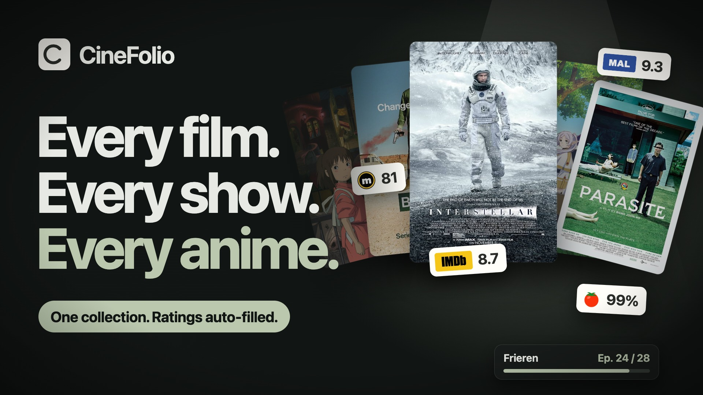

# CineFolio

### Every film. Every show. Every anime. One beautiful collection.

The films you loved, the series you're halfway through, the anime still on your list —
finally, all in one place, looking the way your taste deserves.

**[✦ Start your collection →](https://cinefolio-archive.web.app)**

Sign in with Google. Make it your own.

  

---

  

## Your watch history deserves better than a notes app.

Scattered spreadsheets. Screenshots of recommendations. A watchlist in one app, ratings in another, and no idea which episode you stopped on.

**CineFolio brings it all together.** Search any title, and it arrives complete — poster, story, genres and every rating that matters. Track every episode. Group titles into collections. Share exactly what you want with one link.

No typing. No clutter. Just your cinema.

  

## ✦ Movies, series & anime. One home.

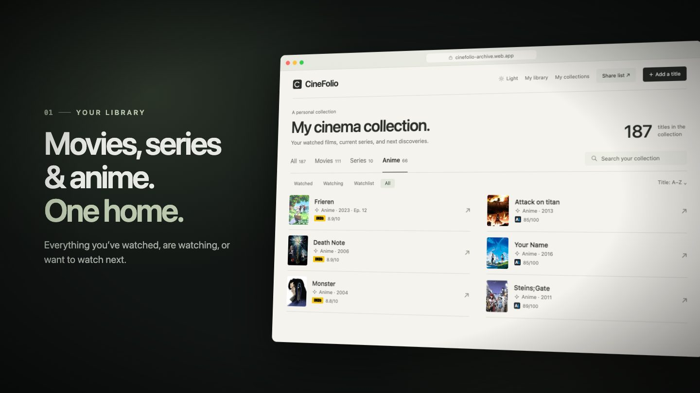

Everything you've **watched**, are **watching**, or want to watch **next** — side by side, with posters, years, episodes and ratings at a glance. Switch between Movies, Series and Anime in a tap.

  

## ✦ Search once. Find anything.

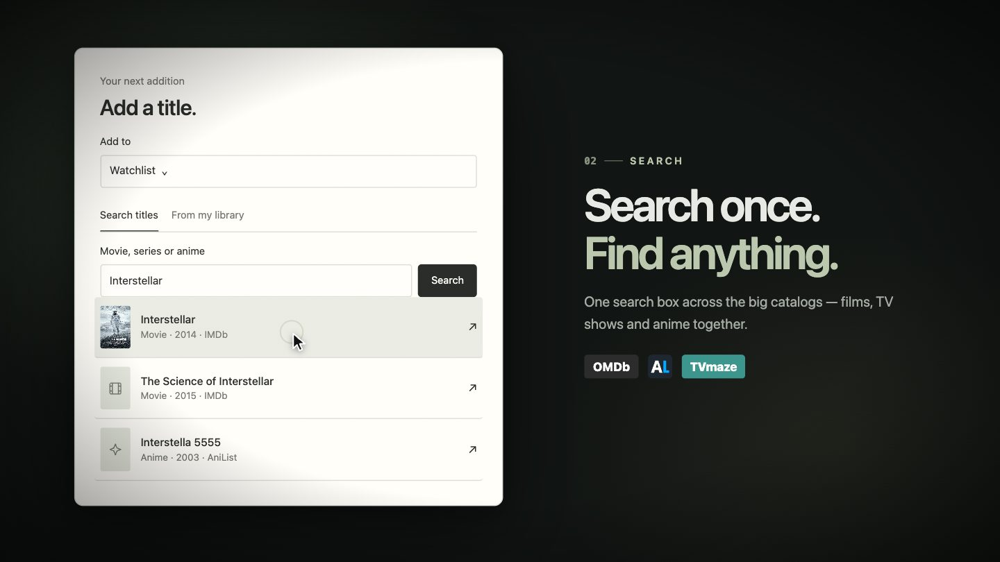

One search box covers the big catalogs at once. Hollywood classics, prestige TV and the anime everyone keeps telling you to watch — they all show up together, ready to add.

  

## ✦ Pick a title. The rest fills itself in.

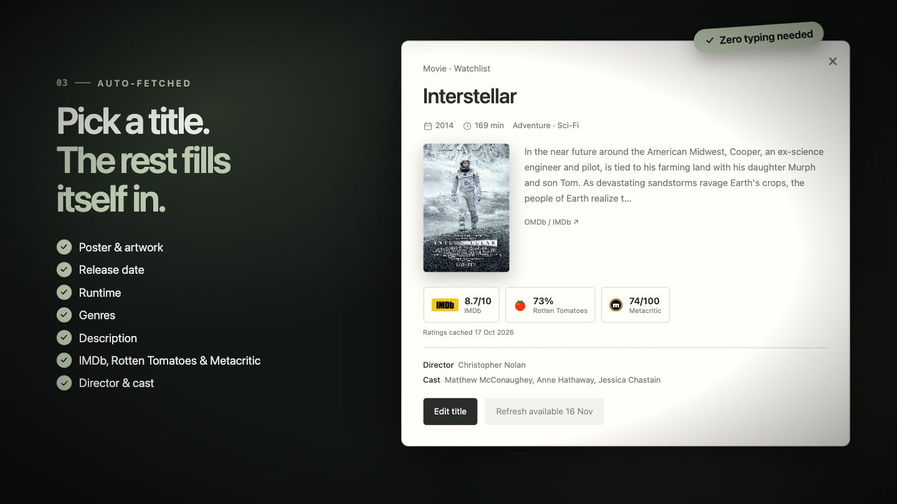

Poster. Release year. Runtime. Genres. Synopsis. Director and cast. Ratings from the sources you trust.

**All of it, automatically.** You just choose what to watch.

  

## ✦ Every rating that matters.

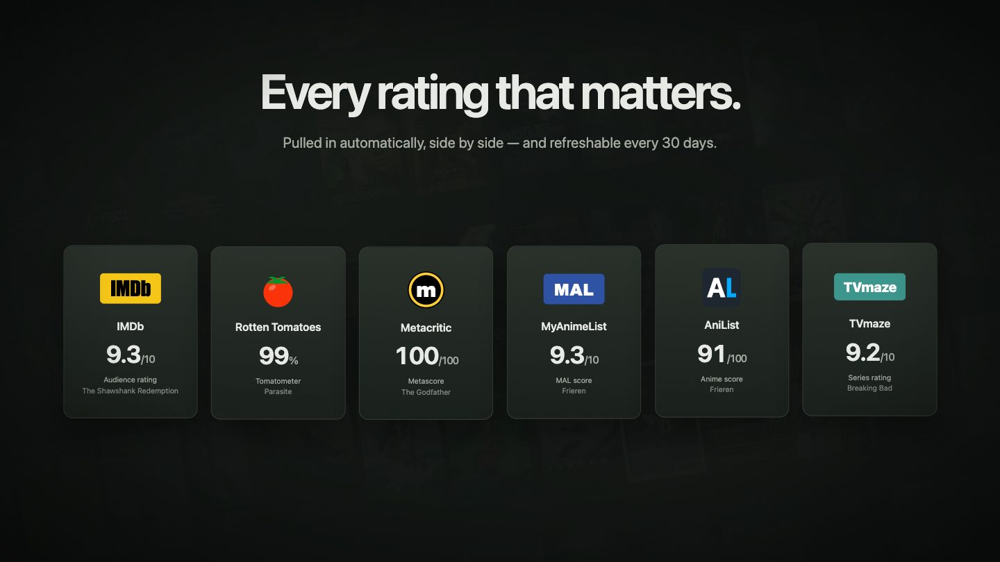

**IMDb · Rotten Tomatoes · Metacritic · MyAnimeList · AniList · TVmaze**

Critics, audiences and anime fans — side by side, so you can make up your own mind. Want the latest scores? Refresh them every 30 days.

  

## ✦ Never lose your place.

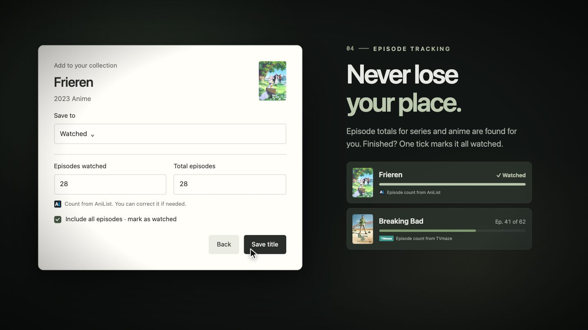

CineFolio finds the episode count for every series and anime for you. Log where you are, see your progress, and when you reach the finale, **one tick marks the whole thing watched.**

  

## ✦ Watched. Watching. Up next.

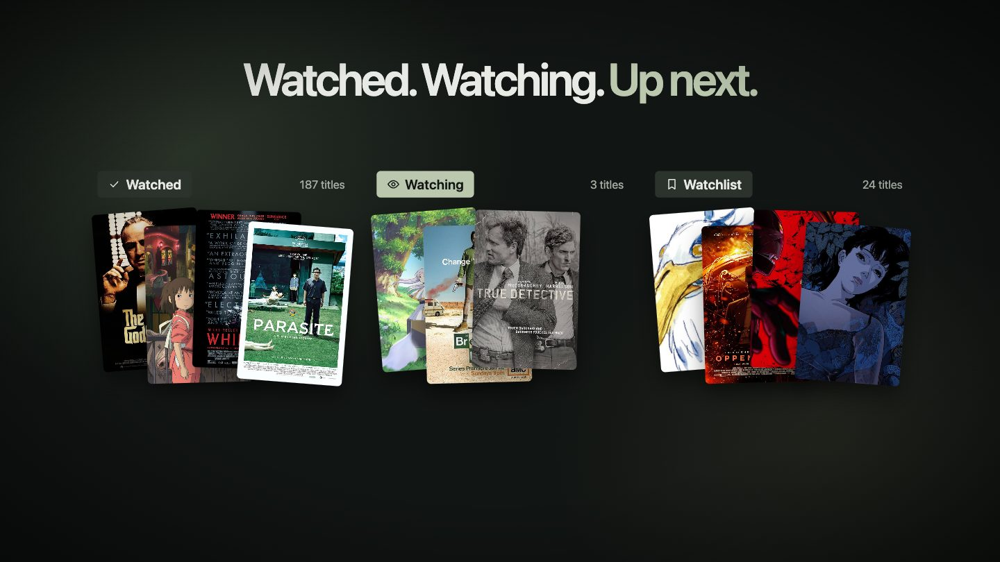

A record of what you loved. A shelf of what you're in the middle of. A watchlist for tonight, next weekend, and someday.

  

## ✦ A collection for every mood.

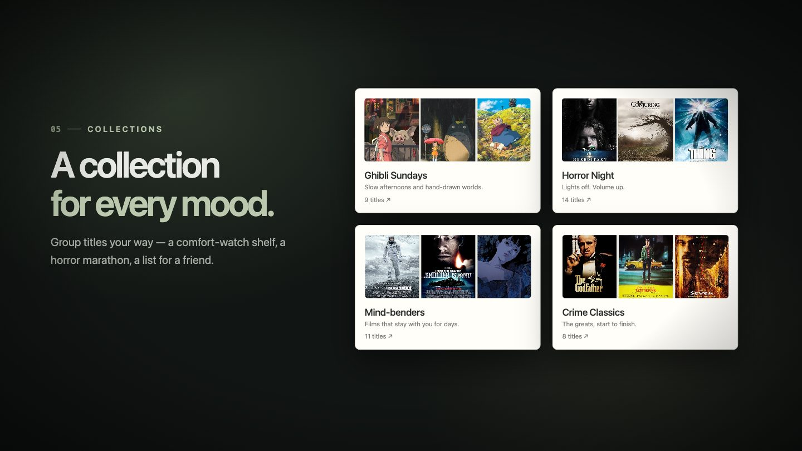

*Ghibli Sundays.* *Horror Night.* *Mind-benders.* *The ones Dad needs to see.*
Make as many collections as you like, each with its own name, description and poster wall.

  

## ✦ Share exactly what you want.

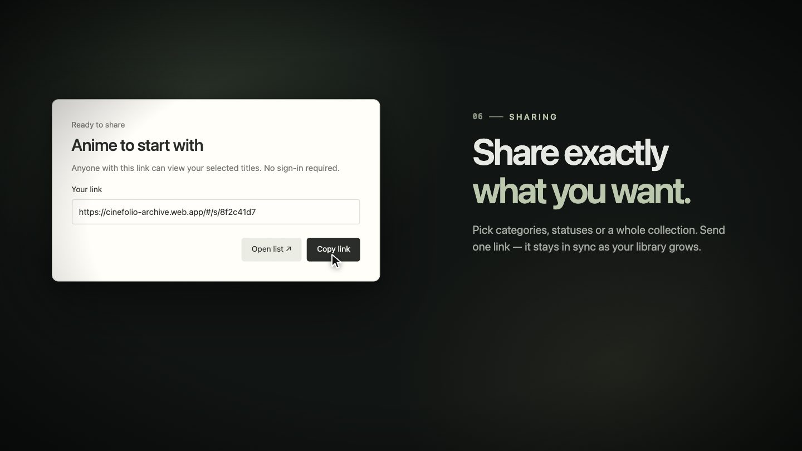

Pick categories, watch statuses or a whole collection, give it a name, and send **one link**.

- Friends **don't need an account** to look.
- Your list **stays in sync** — add a title and they'll see it.
- They can **save your picks to their own watchlist** in a tap.
- Your **private notes are never shared.** Ever.

  

## ✦ Links you control.

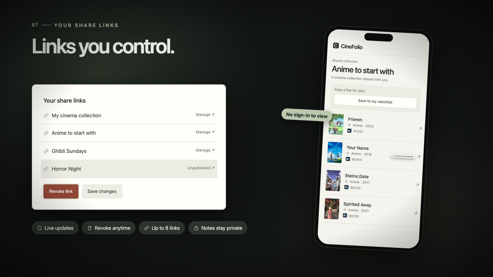

Every list you've shared lives in one place. Copy it, open it, rename it, change what's inside, or **revoke it in a click.** Your library always stays exactly as it is.

  

## ✦ Thoughtful, down to the details.

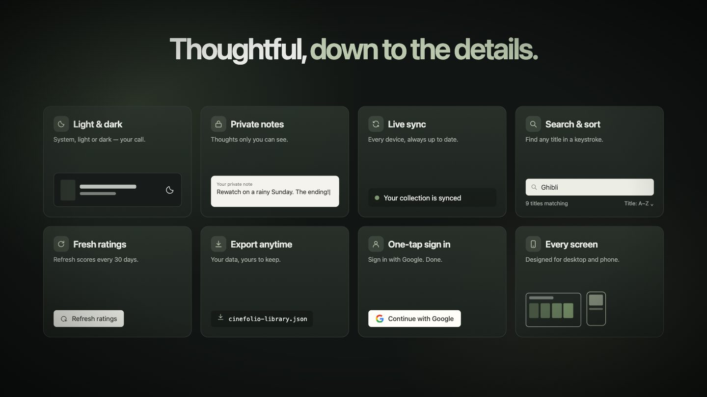

|     |
| --- |
|     |

🌙 **Dark by default.** Easy on the eyes at midnight. Light mode is one tap away.

🔒 **Private notes.** *"Rewatch on a rainy Sunday."* Thoughts only you can see.

🔄 **Live sync.** Add something on your phone, see it on your laptop instantly.

🔎 **Instant search & sort.** Find any title in your collection in a keystroke.

⭐ **Fresh ratings.** Bring scores up to date every 30 days.

📦 **Export anytime.** Your collection, yours to keep — download it whenever you like.

⚡ **One-tap sign-in.** Continue with Google. That's it.

📱 **Every screen.** Designed for phone, tablet and desktop.

  

---

  

## Made for people who…

- 🎬 keep a mental list of every film they've ever loved
- 📺 are three shows deep and always forget which episode they're on
- 🌸 watch anime and want MyAnimeList scores next to IMDb ones
- 💌 get asked *"what should I watch?"* and want to answer with a link
- 🗂️ love a well-organised shelf — even a digital one

  

## CineFolio vs. the usual way

|                                               | Notes app / spreadsheet  | **CineFolio**       |
| --------------------------------------------- | ------------------------ | ------------------- |
| Posters, plots & genres                       | Copy-paste by hand       | **Automatic**       |
| IMDb, Rotten Tomatoes, Metacritic, MAL & more | Six tabs open            | **Side by side**    |
| Movies, series *and* anime                    | Separate lists           | **One collection**  |
| Episode progress                              | "Was it ep. 7 or 8?"     | **Tracked for you** |
| Sharing a list                                | Screenshots              | **One live link**   |
| Private notes                                 | Mixed in with everything | **Always private**  |
| Looks good                                    | 🙃                       | **✦**               |

  

## Questions, answered

**Do my friends need to sign up to see my list?**
No. Anyone with your link can browse it. They only sign in if they want to save titles to their own watchlist.

**Are my notes really private?**
Yes. Notes are stored separately and are never included in anything you share.

**Can I stop sharing a list?**
Any time. Revoke a link from *Shared links* and it stops working immediately.

**Does it work on my phone?**
Beautifully. CineFolio is designed for phones, tablets and desktops alike.

**Can I take my collection with me?**
Of course. Export your whole collection to a file whenever you like.

**Which ratings does it show?**
IMDb, Rotten Tomatoes and Metacritic for films and shows, plus MyAnimeList and AniList for anime and TVmaze for series.

  

---

  

## Every film has a place.

Start your collection today.

**[✦ Open CineFolio →](https://cinefolio-archive.web.app)**

  

Ratings and details from IMDb, Rotten Tomatoes, Metacritic, MyAnimeList, AniList and TVmaze. These are trademarks of their respective owners; CineFolio is not affiliated with or endorsed by them. Poster artwork belongs to its respective owners.
